# 海冰与资源约束下海洋观测节点部署项目总结报告

拟议论文题目：Sparse placement of polar ocean observation nodes under sea-ice and resource constraints

整理日期：2026年10月14日

本报告汇总当前代码、已保存实验、历史报告及论文补全要求。项目已经实现真实极地温度数据对齐、稀疏节点部署、多种重构器比较、约束情景审计以及 RBMF 和 CLBR 的有限机制研究。现有证据支持以50 m温度为主案例、以POD-Ridge为主重构器推进约束部署论文；尚不支持宣称MC-EIR、RBMF或CLBR具有普遍精度优势。软惩罚、集合平均约束与逐节点硬限制的同条件比较，部署策略与重构器的完整交叉评价，以及任务期固定布局的跨时间评价，是论文必须补齐的证据。

本文数值均摘录既有报告与保存结果，未重新拟合模型、调参或开放封存测试。历史报告中“测试”或“HF/LF”等称呼保留于原档，本总结统一按开发暴露历史及产品物理意义解释。所有插图均为项目已生成的原图，新增平台图采用概念数据路径，不冒充实测平台架构。历史全文、全部可找到的图片和轻量证据集中于本目录，文件来源与哈希见 archive_manifest.json。

## 1 研究定位与项目进展

### 1.1 观测任务与优化对象

研究对象是搭载水下传感器链的海洋观测平台在候选海域中的水平站位选择。一个节点表示一个水平观测站位；50 m处传感器是该站位的观测载荷，不能把链上传感器数解释成平台数。平台任务可包含海面气象及水下温盐压力，但当前性能证据主要来自50 m月均原位温度重构。盐度目前用于ORAS5温度物理转换及数据可用性审计，没有完成同站位盐度重构。

论文拟回答三个问题：不同海冰约束表达是否导致不同可行部署；部署效果是否依赖重构器；有限节点与资源预算下，提高可行性需要付出多少误差代价。论文主线应围绕站位选择的工程后果展开，贝叶斯推导与完整逐月诊断转入补充材料。

### 1.2 已完成的工作与继承关系

代码已覆盖POD基底、变分重构、资源约束、候选评分、闭环增点、真实场对齐和比较统计。历史阶段包括合成验证、极地首轮部署、2013选参后的2014探索性比较、P0机制诊断、联合高斯结构诊断和CLBR季度嵌套实验。博士论文已有极地应用、冰情惩罚、节点优化与温盐重构，应在论文中明确继承，不能把复现和工程适配重新表述为新增贡献。

原熵权QR是依据论文信息权重乘QR残差范数的工程约束适配，现有报告没有声称逐式严格复现。补全文献综述时须围绕POD/QR、熵权、重构导向选点与约束部署组织一手文献，逐项核对其信息条件、约束和验证范围。本总结不以未经检索核对的新文献填充创新性论证。

### 1.3 当前研究判断

2014探索性比较中，RBMF优于仅ORAS5，但不优于全部POD基线；各部署策略在RBMF下误差差异极小。2013有限诊断表明原RBMF对在线观测响应很弱，联合α与ρ的候选仅带来微小变化。CLBR恢复了明显在线响应，却仍略差于POD-Ridge，其区间研究也未通过完整预设规则。因此保留这些模型作为研究参照，主工作基线冻结为POD-Ridge，并保留POD-LASSO与Gaussian-SBL。

### 1.4 贡献的待验证表述

拟议贡献为建立物理含义明确的约束部署问题、识别海冰约束表达与部署策略的工程后果、通过跨重构器实验量化部署结论的稳定性。这三项是后续验证目标，目前不能作为已经完成的论文结论。“entropy-weighted”仅在新增机制获得稳定独立收益后考虑进入题目；“robust Bayesian multi-fidelity”不宜继续作为中心定位。

## 2 观测平台与约束部署问题

### 2.1 平台数据路径与优化边界

概念数据路径为“固定垂向水下传感器链 → 浮标网关 → 岸端接收与场重构”。水下链观测50 m温度等载荷变量，浮标负责采集转发，岸端进行质控、重构及规划。正式平台示意图必须核实实际接口、供电、链路与网关角色后绘制；现有单网关通信情景不等同上述硬件架构已经验证。本文仅优化水平站位，垂向配置固定。

### 2.2 候选域及数值可行性

主要部署案例位于北大西洋侧70–80°N、20°W–20°E，固定共同有效格点346个；中央北冰洋数据对齐域为80°N以北3305格点，不能把数据准备域误写成已完成全部部署验证的区域。共同域由训练参考场有效性、温度恢复偏移有效性与静态海洋掩膜定义，不根据评价年份温度改变区域。尚无完整岸线、海深和系泊适用性筛选证据，数值格点可选不等于实地可布放。

### 2.3 海冰约束语义

布放期可达性表示船舶或平台能否到达站位；服役期暴露表示任务期内的冰情风险。逐节点硬上限要求每个已选站位满足阈值，集合平均限制约束总体平均暴露，软惩罚只改变选点评分。平均达标仍可能存在高风险单点；软惩罚也不提供硬可行性保证。缺测、陆地、海岸与极区空洞均保持未知，不能填为无冰。

现有首轮案例海冰浓度上限0.6属于情景假设，没有设备适冰认证支撑。后续可将其作为敏感性参数，但不能声称对应真实设备的安全阈值。还需确定服役期暴露采用最大值、超阈月份比例还是其他任务统计量，保持定义与可获得环境资料一致。

### 2.4 节点和资源预算

已有案例从4个初始节点增至12个站位。首轮声明网关75°N、0°E，通信半径250 km，任务1小时，网络能量预算1000000 J；功率、发包与成本参数均为工程情景。正式论文优先以节点预算和冰情约束建立主问题；通信、能耗与维护成本作为参数明确的扩展，不把模拟可行率推广为真实长期海洋平台保证。

### 2.5 优化与评价定义

设候选集合为V，布局S⊆V，节点数|S|≤K。逐点约束可写为h_i≤τ，平均约束为Σh_i/|S|≤τ̄，资源约束为E(S)≤B_E、C(S)≤B_C；其阈值和冰情统计量需预先冻结。软惩罚可在基础选点评分中扣除βh_i，不能替代上述可行集合。部署只能利用训练信息、环境信息及已获取观测，未观测参考场用于事后评价。

统一未观测评分域G，面积加权RMSE为sqrt[Σ_{i∈G}w_i(x̂_i−x_i)² / Σ_{i∈G}w_i]，w_i=cos(latitude_i)。主要指标同时报告逐点违规率、整套布局可行率、预算达到率和实际节点数；预算不足、无候选、QR有效增益耗尽及求解失败均保留。不同方法不得通过改变评分域获得表面优势。

## 3 部署方法与重构器

### 3.1 基线和约束处理

已有部署比较包含Random、Maximin、POD-QR、熵权QR、条件熵、后验方差、方差下降、MC-EIR及评分消融。后续主比较至少保留Random、Maximin、POD-QR、原海冰软惩罚熵权QR和拟议约束方法。逐点筛选、集合预算检查、候选评分应依次执行并记录拒绝原因；小规模候选用枚举或可靠参考解检查贪心选择，未证明时不宣称全局最优。

### 3.2 MC-EIR评分的现有边界

MC-EIR组合信息、方差变化、冗余及成本相关评分，方差下降使用冻结超参数的高斯近似，未对未来完整VB重拟合精确积分。2013选择的beta=0.25、eta=0，意味着本轮完整方法本就不含非零冗余惩罚，去冗余消融相同不能证明冗余机制有效。后续先检验简单信息或重构风险准则；融合项必须说明量纲、归一化及重复信息，增加评分项本身不足以构成独立创新。

### 3.3 主重构器及模型参照

POD-Ridge采用训练POD前16阶、λ=0.01；POD-LASSO采用16阶、λ=0.1；Gaussian-SBL采用前4阶、aγ=bγ=0.001。参数来源为2013开发选择及冻结配置。RBMF固定参照采用32阶及已选先验，不继续扩展搜索。跨重构器比较必须共享站位、观测与评分域，参数仅从训练及开发数据选择。

### 3.4 RBMF与CLBR有限研究结论

P0没有发现单位、标准化或POD归一化错误；完整因子停止与联合α–ρ推断未解决真实场收缩。条件解析诊断说明原辅助兼容目标本身可偏好小ρ；这个结果只针对该目标，不能推广为所有多保真模型的缺陷。CLBR使用正规仿射LF均值与贝叶斯残差生成模型，避免全域残差为零的辅助似然，作为独立模型研究而非原实现修复。它增强在线响应，但未达到相对Ridge的预设精度门槛。

### 3.5 固定布局与顺序增点

现有闭环按观测逐点增加站位，应解释为分阶段布放。各月份分别规划与任务期固定站位的后续月评价不同，不能描述为浮标自动迁移或已验证季节自适应。主文优先固定任务期布局，顺序扩展单列新增布放和运维成本；固定布局跨时间实验尚待补齐。

## 4 数据与实验设计

### 4.1 数据来源和物理处理

IAP为格点参考场，ORAS5为辅助产品，HF/LF仅是历史模型命名。IAP绝对温度依历史偏移恢复并用2001年交叉核对，未使用不匹配的2024气候态；其异常基准版本仍需资格审计。ORAS5使用ICDC r1x1/opa0、静态tmask，结合实用盐度、压力和经纬度做TEOS-10位温至原位温度转换，再插值至50 m和IAP格点。47.211895 m和53.850636 m夹住目标深度。月均转换存在非线性平均近似。

海冰采用G02202 V6 F17北极月产品，0–1浓度，2013配套为25 km网格、最近邻映射并保留QA与未知值。IAP与ORAS5的相对精度及内部同化依赖未经独立点观测验证，不能声称普遍高低保真关系。Argo/ITP已完成空间与深度对齐，但尚未形成本论文的独立性能验证。

### 4.2 时间划分和评价资格

2000–2012共156个月用于气候态、尺度、POD和协方差训练；2013全年用于选参和路线开发；2014年1、4、7、10月已反复查看，属于探索性评价。2015–2025为11个完整候选年度，2026仅1–4月；候选已做元数据和质量审计但未开展预测性能评价。现有封存状态release_authorized=false，缺少合格配套产品及版本依据，不因本总结获得独立测试资格。

### 4.3 已有实验与信息条件

| 阶段 | 数据与规模 | 可支持的结论 |
|---|---|---|
| 极地首轮部署 | 2014四个月，三策略，4→12节点 | 初步可行性和误差现象 |
| 参数选择后比较 | 2013选参；2014四月×30种子×10场景，共1200案例 | 固定开发条件下重构及部署比较 |
| P0与结构诊断 | 2013全年、5预算、两场景、3配对种子 | 机制、有限候选与停止决定 |
| CLBR嵌套研究 | 2013四个连续季度外层留出及内层选择 | 开发年份分块下的有限模型评价 |

2014重构分支采用共同Maximin布局，部署分支固定RBMF。这是两类控制实验，尚不是每个部署布局交给每个重构器的完整交叉矩阵。CLBR季度嵌套降低折内泄漏，不能消除2013长期路线开发产生的选择偏差。

### 4.4 必须补齐的比较和统计

后续冻结方法后，在相同候选、预算和主重构器下依次比较无冰处理、原软惩罚、集合平均限制和逐点硬限制，设置未触发、部分触发与较强约束情景。无约束布局单列为性能代价参照。随后将各布局交给Ridge、LASSO、SBL评价，报告策略与重构器交互、排名变化及配对差值，另开展固定布局跨月评价。

既有污染包括0.02℃高斯噪声、等方差t(3)、离群、缺测、LF偏移和训练污染，范围按原协议解释。新增扰动强度与节点失效方案应实验前规定。统计先按时间块汇总配对差值；种子仅表征同一环境内随机性，不能当独立环境数。失败与未达预算保留，并明确各均值的分母。

### 4.5 复现与整理状态

历史报告记录了正式比较1558811项核查、199200份预测指标重算，结构诊断最终81项测试、CLBR最终95项测试及独立外层/内层/区间核验。上述是历史验收记录，本轮只核验归档文件与报告引用，不把它们写成今天重新运行的测试。原数组、输入和压缩轨迹仍在原位置，不能仅凭图片和均值恢复所有实验。

## 5 结果与讨论

### 5.1 探索性重构结果与布局

2014参数选择后、clean、12节点、相同Maximin站位的RMSE如下。其120个案例来自四个月×30种子，确定性clean重复不代表120个独立环境。

| 重构器 | 面积加权RMSE ℃ | 达到预算且收敛案例 |
|---|---:|---:|
| 仅ORAS5 | 0.706389 | 120/120 |
| POD-Ridge | 0.474100 | 120/120 |
| POD-LASSO | 0.439841 | 120/120 |
| Gaussian-SBL | 0.451626 | 120/120 |
| 确定性多保真 | 0.628681 | 120/120 |
| RBMF | 0.528708 | 120/120 |

RBMF比仅ORAS5误差低约25.2%，但比Ridge高约11.5%，比LASSO高约20.2%。该年度排序与2013整体排序不同，支持开展跨时间及跨重构器评价，不支持挑选一个年度宣布普遍优势。

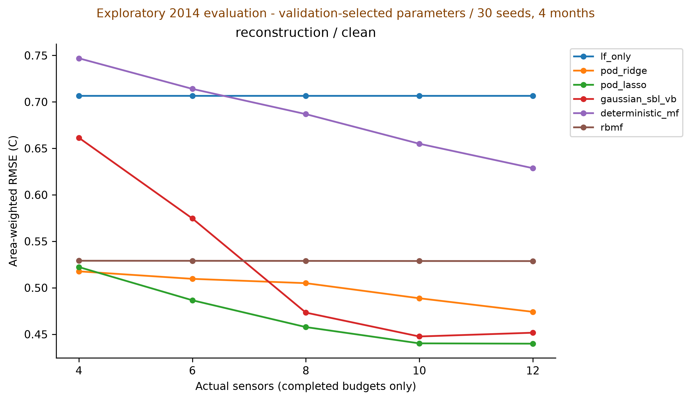

图1来源：2014探索性正式比较已生成原图。展示多预算关系，不是独立测试曲线。

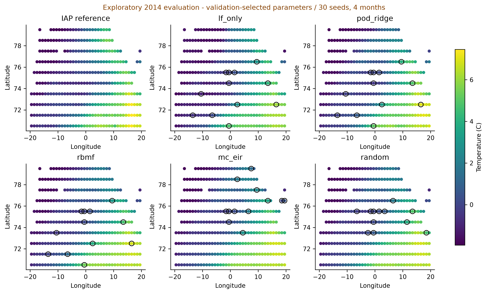

图2来源：201401、seed0、clean、12节点，按最早月份、最小种子、最大计划预算预先规则选取。共同温度色标约−1.9475至7.4600℃。地图可展示布局与空间误差，但单张图不能证明部署合理性或季节稳定性。

### 5.2 部署策略与约束代价

在固定RBMF重构器下，2014 clean、12节点的Random、Maximin、POD-QR、熵权QR与MC-EIR误差分别为0.528754、0.528711、0.528830、0.528869、0.528791℃。MC-EIR未优于Random或Maximin；差异仅数十至百余微℃，图的放大刻度不能解释为实用精度优势。

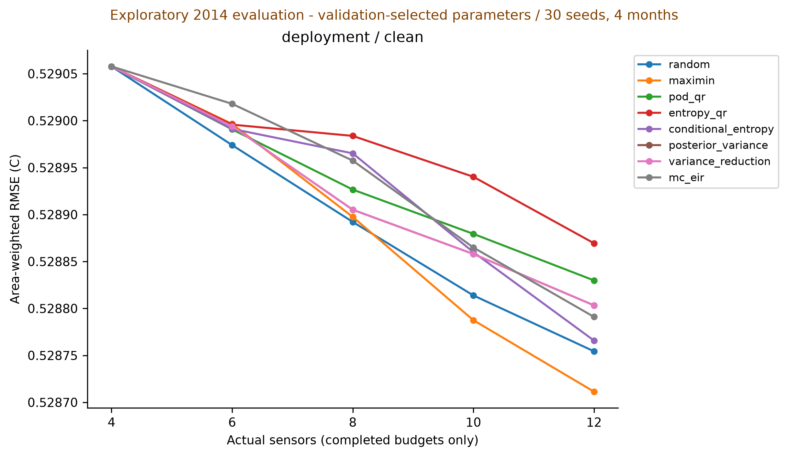

图3来源：固定RBMF的部署比较。部署收益可能被弱观测响应遮蔽，需在Ridge等重构器下重新检验，不能直接断言所有策略等价。

| 策略及约束状态 | clean RMSE ℃ | 按原情景审计可行率 | 场景成本 |
|---|---:|---:|---:|
| 约束POD-QR | 0.528830 | 1.000000 | 13.017000 |
| 无约束POD-QR | 0.528753 | 0.000000 | 13.801500 |
| 约束MC-EIR | 0.528791 | 1.000000 | 12.037500 |
| 无约束MC-EIR | 0.528761 | 0.000000 | 12.060000 |

无约束参照误差稍低却均不满足原情景约束，约束版本的误差增量分别约0.000077和0.000030℃。这只能量化当前复合情景的代价，不能分离纯海冰贡献，也不能代替软惩罚、平均限制与逐点硬限制的比较。不可行布局的任务能耗保持不可用。

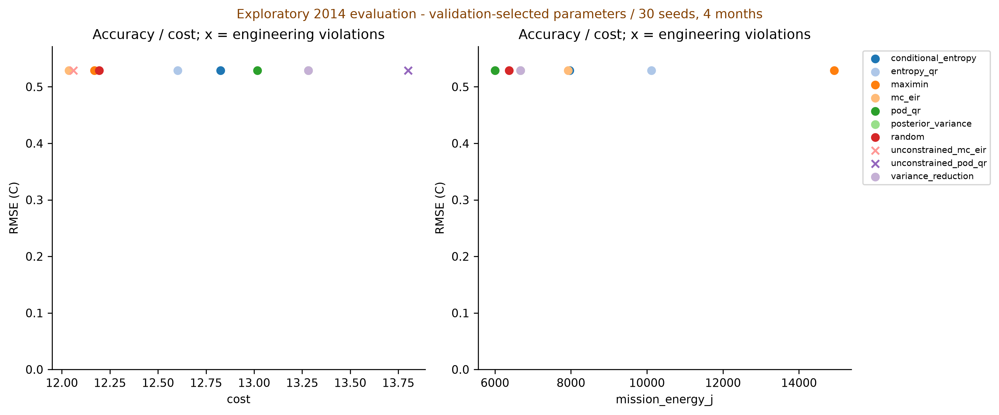

图4来源：原约束及无约束参照。工程成本和能耗使用情景参数，尚无实测设备依据。

### 5.3 重构器依赖与RBMF机制

2013全年、全部预算平均的Gaussian RMSE：月气候态0.457304℃、原RBMF0.456787℃、联合因子0.456764℃、Ridge0.388969℃、LASSO0.402783℃、SBL0.415612℃。这些与上文2014最大预算均值属于不同汇总条件，不能并作同一排名表。

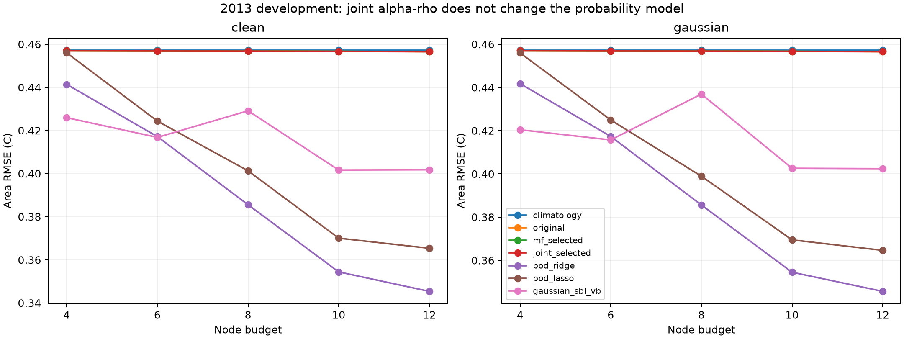

图5来源：2013开发验证结构诊断。联合候选Gaussian相对气候态改善仅0.1182%，4→12节点改善0.0894%；Ridge分别为14.9431%和21.7570%。联合候选不通过预设5%和2%门槛，不提升为正式方法。

原RBMF冻结因子的系数有效自由度约0.073，rho约0.0008；首观测增加0.02℃后完整重拟合场RMS变化平均约0.0000152℃。联合因子仍保持弱响应。条件解析及低维数值参考区分了兼容目标收缩与均场近似误差；没有找到单独改变停止或α–ρ相关性就能解决的依据。该机制解释支持更换主评价器，但尚未完成策略×重构器的全交叉验证。

### 5.4 CLBR部分改善与不确定性边界

CLBR在2013季度嵌套开发评价中的Gaussian RMSE为0.393560℃，Ridge为0.388969℃；CLBR高约1.180%，仅5/12个月优于Ridge，未达到至少5%改善及8/12个月改善门槛。相对自身无观测预测，12节点在线更新场RMS变化约0.19353℃，说明在线贡献恢复，但不能由此推出超过强基线。

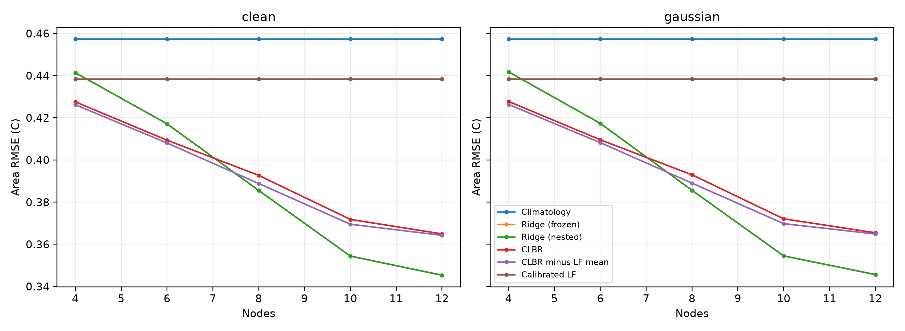

图6来源：2013嵌套开发结果。冻结Ridge与严格折外Ridge最终选参相同，曲线重叠属于结果一致，不是遗漏方法。

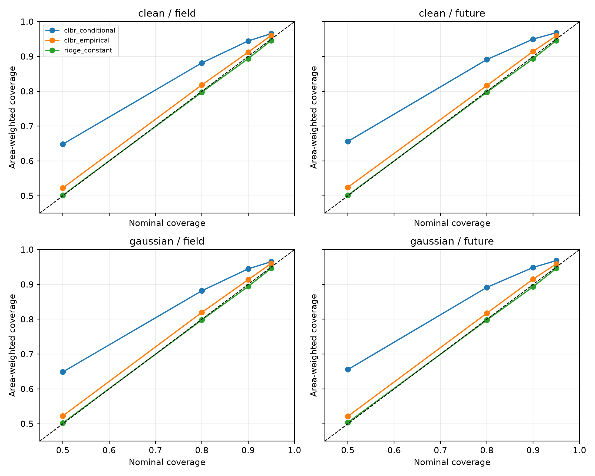

图7来源：边际潜在场及未来模拟观测区间。Gaussian潜在场经验CLBR的50/80/90/95%覆盖为52.25/81.95/91.35/96.04%，90%宽度1.3333℃；Ridge常宽区间对应50.22/79.79/89.41/94.65%，宽度1.2681℃。覆盖达标仍须结合宽度与评分。

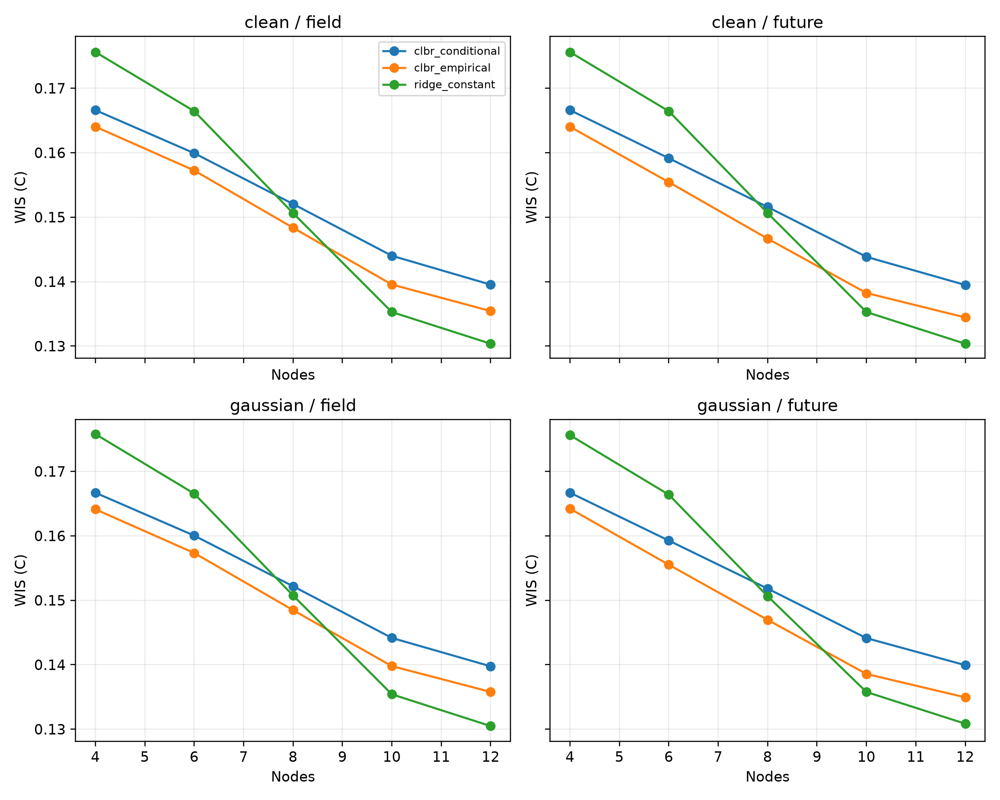

图8来源：WIS预算曲线。经验CLBR各场景与目标的WIS改善约1.78%–2.57%，低于5%，且只有6/12个月改善，未通过完整区间验收。经验残差校准没有产生真实传感器或全场同时覆盖保证；条件后验也未传播全部参数和基底学习不确定性。

### 5.5 适用范围及补全优先级

现有结果来自格点参考场模拟采样、单一主要区域和50 m温度，包含产品同化依赖、设备参数假设、开发数据反复暴露和有限时间样本。不能推广为完整海洋多参数监测系统，也不能凭当前全可行率声称长期实海部署安全。若新约束方法未优于强基线，应报告适用条件或停止提升贡献，保留全部对照与失败。

| 优先级 | 补充工作 | 形成证据 |
|---|---|---|
| 必须 | 平台架构和约束语义核对 | 优化问题对应实际站位任务 |
| 必须 | 软惩罚、平均限制、逐点硬限制同条件比较 | 分离海冰贡献与单节点违规 |
| 必须 | 策略布局交给Ridge、LASSO、SBL评价 | 识别部署效应及重构器交互 |
| 必须 | 固定布局的跨时间评价 | 检验任务期稳定性 |
| 优先 | 盐度与同站位温盐评价 | 支撑多变量适用性 |
| 条件具备后 | 实测设备及独立点观测 | 支撑工程及外部验证 |

主文保留平台图、候选域与冰情图、布局图、精度预算图、约束代价图和跨重构器图。当前平台、三类冰情约束对照、固定布局跨时间和完整交叉图尚无对应合格实验，本报告不生成替代数据。原第1–2章合并重写，第3章补平台与约束，第4章推导压缩，第5章改写部署机制，第6–7章重组为实验和结果；最终正文六章，每章小节不超过五个。

## 6 结论与交付状态

### 6.1 三个研究问题的当前回答

不同冰情表达可能产生不同可行集，但现有实验尚未以同条件三类对照证明其工程差异；平均约束掩盖单节点违规是必须检验的机制。部署策略效果的重构器依赖具有明确风险：RBMF响应弱且强基线更好，现有分支比较不足以排除模型交互。有限资源下可行性代价已有复合情景的初步数值，尚未分离冰情、通信及资源各自作用。三个问题均应按上述边界写作，不能作为已全部解决的贡献。

### 6.2 项目成果与停止决定

项目已经形成可执行代码、真实温度数据物理处理、预先定义的比较协议、保存结果独立核验和有限候选停止记录。负结果提供了选取主重构器与收敛研究范围的依据。后续保持POD-Ridge主基线与LASSO/SBL对照，RBMF/CLBR作为固定研究参照；不根据已查看年份继续扩大候选以制造优势。

### 6.3 报告整理与本地清理边界

历史文档、已生成论文图及轻量证据集中在reports；README.md为索引，archive_manifest.json为来源和哈希，cleanup_inventory.json与清理说明.md记录候选删除范围。本轮按用户要求不删除虚拟环境、缓存、数组或原始数据，不提交和推送GitHub。当前仍有未跟踪核心文件；远程备份完整性尚未联网验证。清理前应确认这些代码及必要数值复现材料另有备份，且保留独立测试封存资格与数据来源记录。

### 6.4 证据来源和复现入口

关键来源为归档中的 docs/comparison_formal_report.md、polar_deployment_report.md、real_data_alignment_report.md、polar_validation_2013_report.md、p0_research_report_v1.md、p0_structure_report_v1.md，以及 outputs/clbr_p1_report_v1/report_zh.md。每张图的相邻说明给出实验资格；数值核验和参数见evidence对应目录。执行入口保留于原scripts、configs、tests和依赖文件。历史报告原样保留，其中当时的Git状态或早期测试称呼不代表整理日状态。完整历史清单见本目录README。

### 6.5 已完成实验的补充图集

以下补充收录其余最终结果图，便于论文取材。图9–13来自2014探索性比较，图14–16来自2013开发诊断，图17–20来自CLBR季度嵌套开发评价。它们与正文图1–8合计20张，涵盖目前主要结果报告的最终PNG图；历史目录另保留SVG、PDF及早期运行/核验图。图集不改变正文中的证据资格和停止结论。

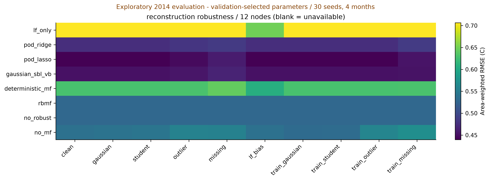

图9使用协议规定的污染强度，不能推广为任意污染下鲁棒优势。

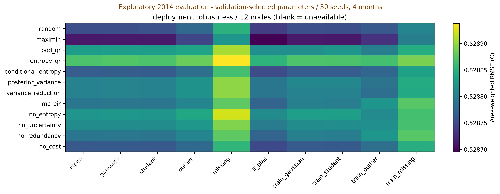

图10色轴放大了极小误差差异，应结合数值尺度阅读。

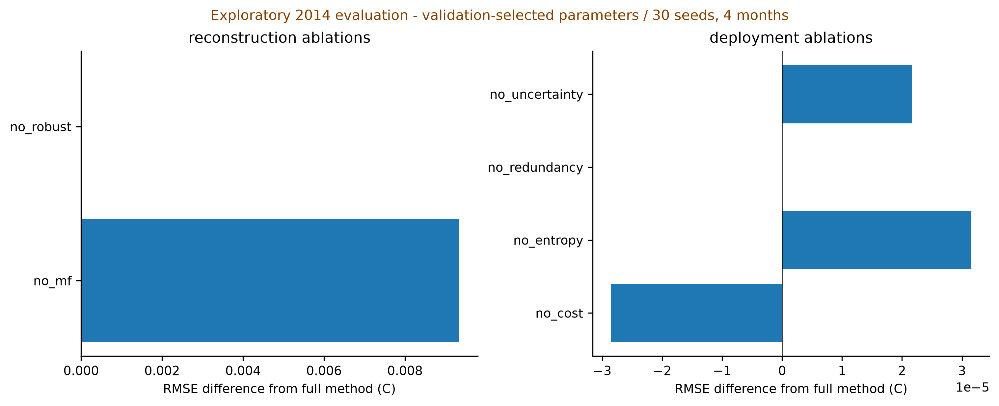

图11去冗余与完整评分相同源于选定eta=0，不能作为非零冗余机制的验证。

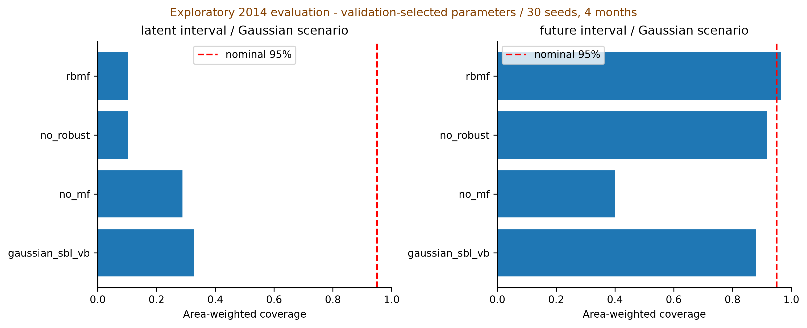

图12潜在场覆盖与未来观测覆盖对象不同，不得混用。

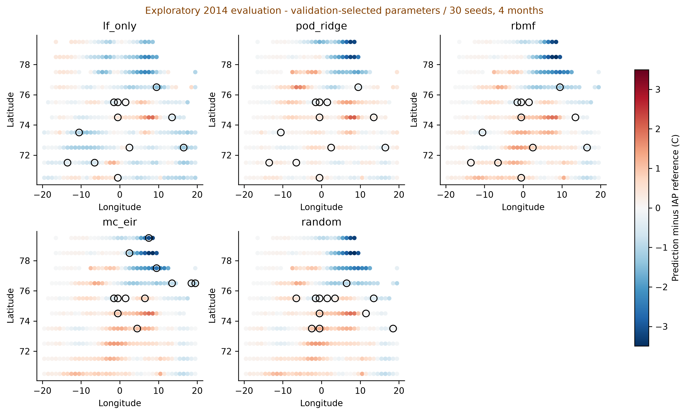

图13与图2使用相同201401代表案例，误差色标约−3.4973至3.4973℃。

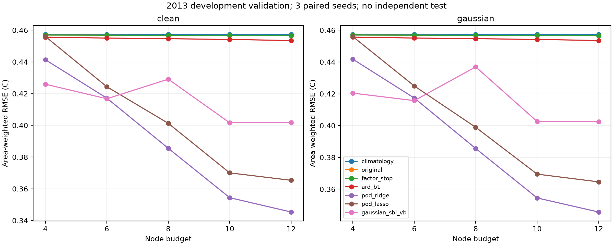

图14保留固定噪声条件对照与未通过门槛的候选，不把已知模拟器噪声条件视为可部署信息。

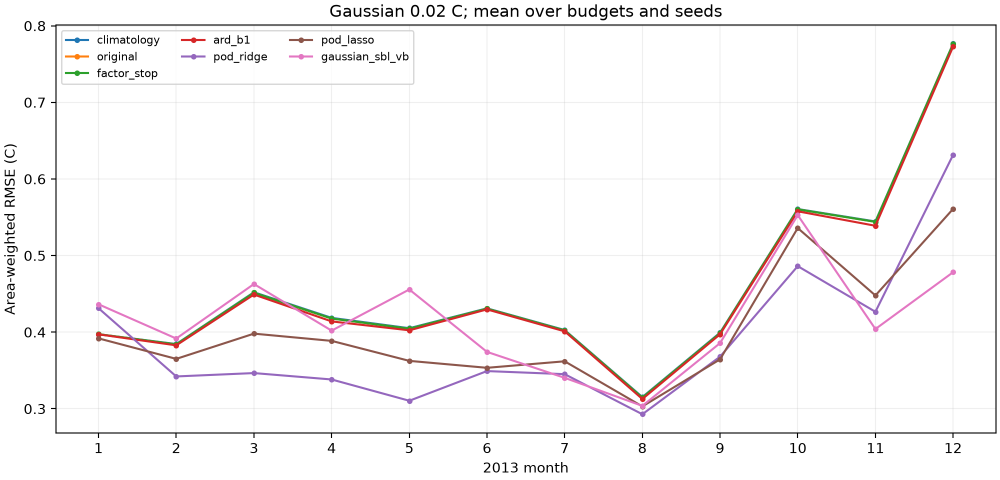

图15保留月份差异与非单调结果，种子重复不是新增环境。

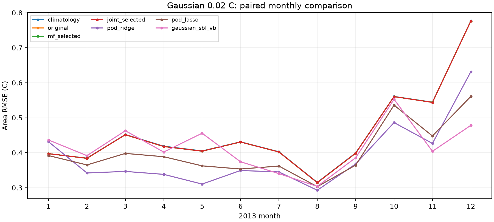

图16联合候选虽多月略好于气候态，改善幅度仍未达到验收。

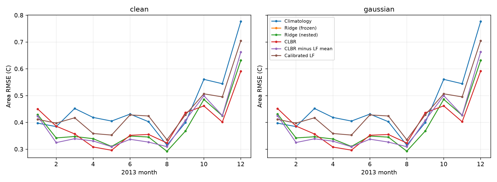

图17 CLBR仅5/12月优于Ridge，不因局部优势提升为正式方法。

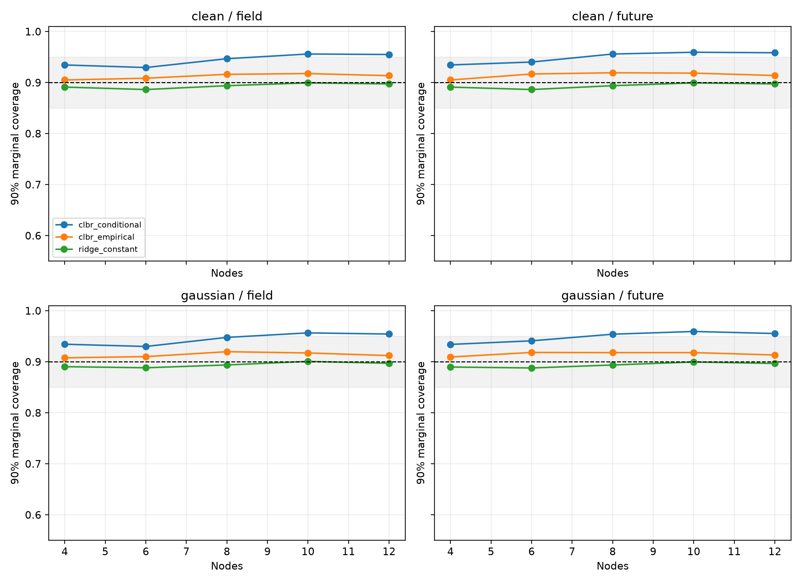

图18覆盖须同时结合宽度和WIS，名义90%不是全场同时覆盖。

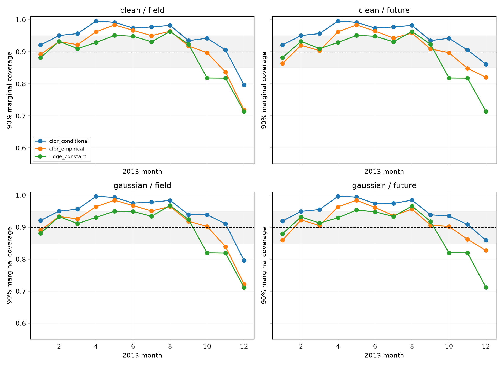

图19保留局部失准，2013仍为开发年份。

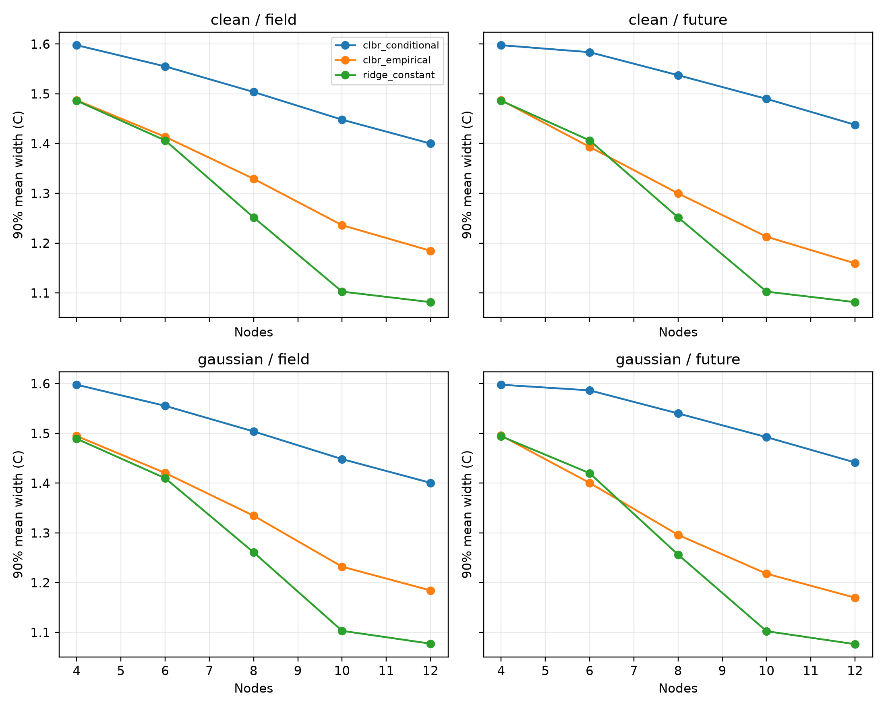

图20经验区间相对Ridge的宽度增加约3.5%–5.1%，完整区间验收仍因WIS和月份门槛失败。
